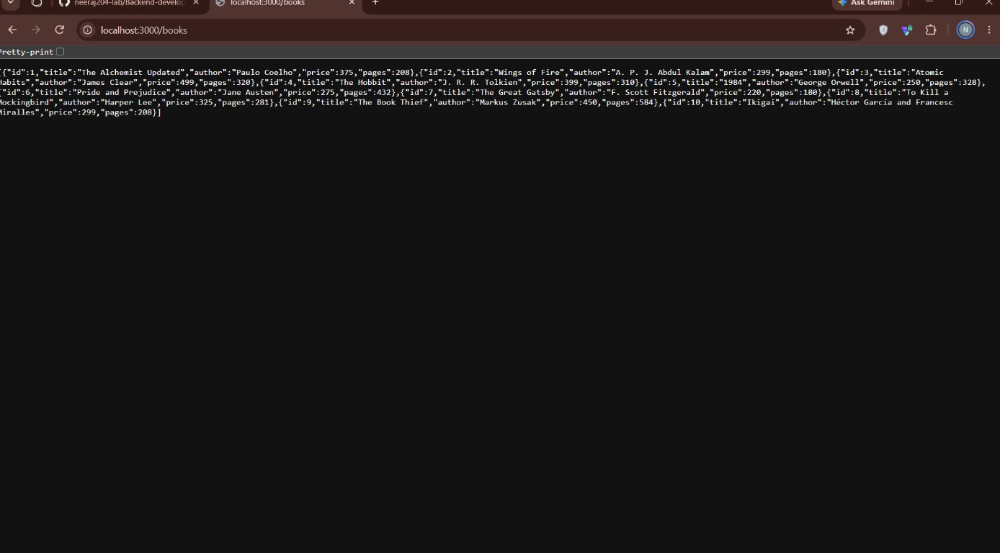
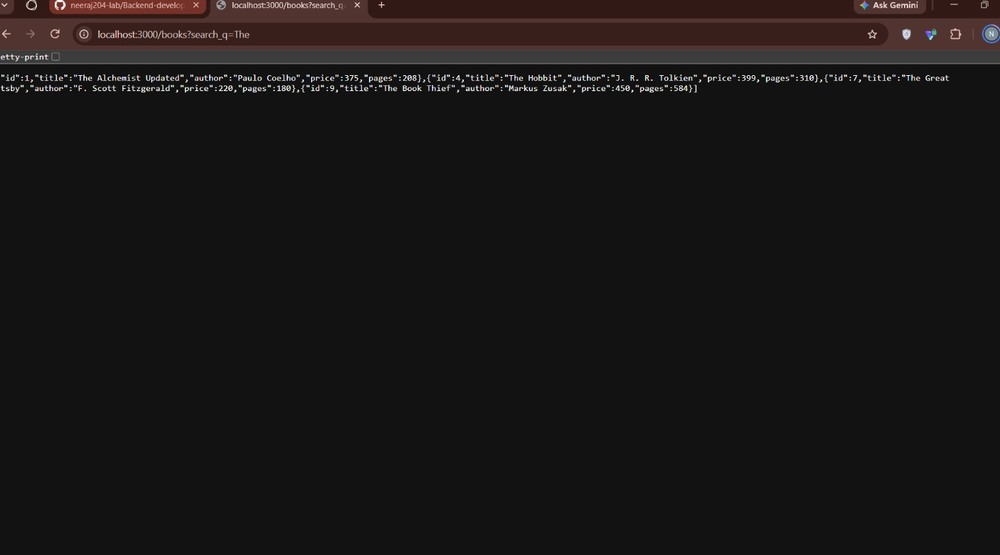
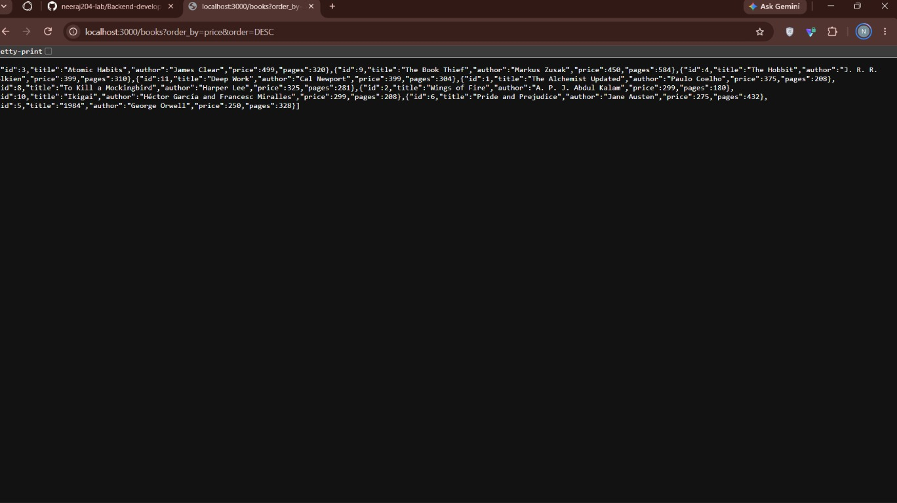
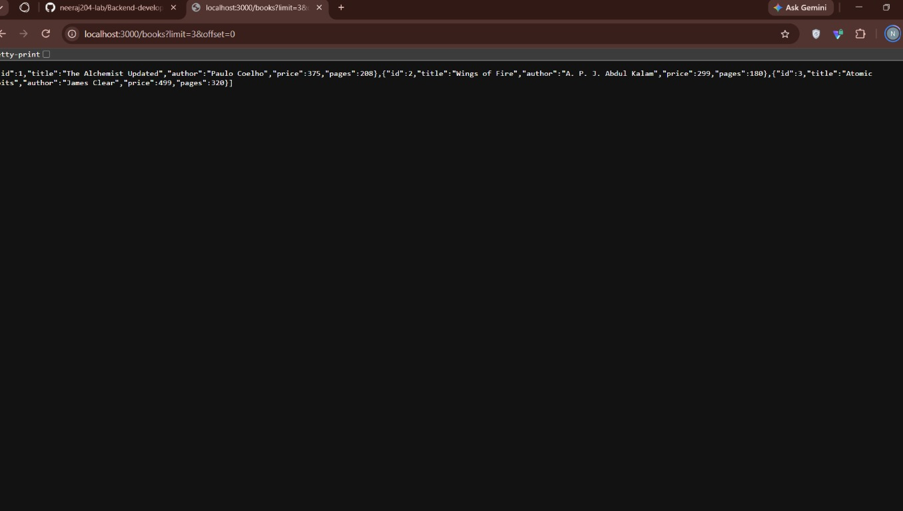
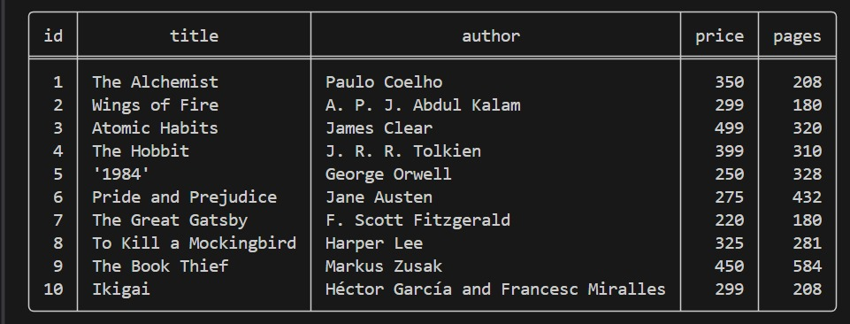

# Lab 3: REST API, Query Parameters, Validation and Debugging

**Name:** Latchipatruni Charan Teja  
**Registration Number:** 252U1R8045  
**Class:** B.Tech CSE(QE) – 2B  
**Section:** S-13 204

## Objective

Turn the Lab 2 routes into a clean REST API with search, sorting, validation, correct status codes, and practise debugging common errors.

## Technologies Used

- Node.js
- Express.js
- SQLite
- `sqlite` and `sqlite3`
- Nodemon
- Postman

## Project Setup and Execution

1. Open a terminal in the `lab3` folder.
2. Install the project dependencies:

   ```bash
   npm ci
   ```

3. Start the development server:

   ```bash
   npm run dev
   ```

4. The server runs at:

   ```text
   http://localhost:3000
   ```

5. Run the API test suite (stop the development server first so port 3000 is available):

   ```bash
   npm test
   ```

## Database

The SQLite database is located at `database/books.db`.

The `book` table contains the following columns:

| Column | Data Type | Description |
| --- | --- | --- |
| `id` | INTEGER | Primary key |
| `title` | TEXT | Book title |
| `author` | TEXT | Book author |
| `price` | INTEGER | Book price |
| `pages` | INTEGER | Number of pages |

The database contains 10 sample book records used for implementing and testing the API features.

## API Endpoints

| Method | Endpoint | Description |
| --- | --- | --- |
| GET | `/books` | Retrieve all books with search, sorting, pagination and price filtering |
| GET | `/books/:bookId` | Retrieve a book by its ID |
| POST | `/books` | Add a new book |
| PUT | `/books/:bookId` | Update a book by its ID |
| DELETE | `/books/:bookId` | Delete a book by its ID |

For POST and PUT requests, send a JSON body containing `title`, `author`, `price`, and `pages`.

## Query Parameters

The GET `/books` endpoint supports the following query parameters:

| Parameter | Description | Example |
| --- | --- | --- |
| `search_q` | Search books by partial title | `search_q=The` |
| `order_by` | Specify the sorting column | `order_by=price` |
| `order` | Specify ascending or descending order | `order=ASC` |
| `limit` | Specify the maximum number of records | `limit=3` |
| `offset` | Specify the number of records to skip | `offset=3` |
| `min_price` | Filter books by minimum price | `min_price=250` |
| `max_price` | Filter books by maximum price | `max_price=400` |

Example combined request:

```http
GET /books?search_q=The&order_by=price&order=ASC&limit=2&offset=0
```

This request searches books with titles containing "The", sorts the results by price in ascending order, and returns a maximum of two records.

## Validation and HTTP Status Codes

The API validates incoming POST and PUT request bodies.

- Book title and author are required.
- Price must be provided as a valid numeric value.
- Pages are required.
- Invalid request data returns `400 Bad Request`.

The API uses the following HTTP status codes:

| Status Code | Description |
| --- | --- |
| 200 | Successful retrieval, update or deletion |
| 201 | Book successfully created |
| 400 | Invalid request data |
| 404 | Requested book not found |
| 500 | Internal server error |

Error responses use a consistent JSON message format.

## Screenshots

### 1. List all books



### 2. Search books



### 3. Sort books by price in descending order



### 4. Paginate books



### 5. SQLite database records



## Debugging Exercises

The following common errors were practised as part of the lab:

1. **EADDRINUSE:** Occurs when the requested server port is already occupied.
2. **Wrong Import Path:** Occurs when Node.js cannot locate the required module.
3. **Incorrect Table Name:** SQLite returns a `no such table` error when the specified table does not exist.
4. **Missing await:** Demonstrates problems caused by not properly waiting for asynchronous database operations.

## Problems Faced and Solutions

- Port conflicts can prevent the Express server from starting. Identified the process occupying the port and practised resolving the conflict.
- Incorrect module paths can cause module loading failures. Checked the import paths and project file structure.
- Incorrect SQLite table names can cause database query failures. Verified the database table name.
- Missing `await` can cause asynchronous operations to be handled incorrectly. Used `await` to handle database operation results.

## Notes

- SQL queries use `?` placeholders for user-provided values.
- Sorting columns are restricted to an approved list of column names.
- Search, sorting, pagination and price filtering can be combined in a single GET request.
- Invalid request data is handled using appropriate HTTP status codes.
- Error responses follow a consistent JSON structure.
- `node_modules` and `.env` files should not be committed to GitHub.
